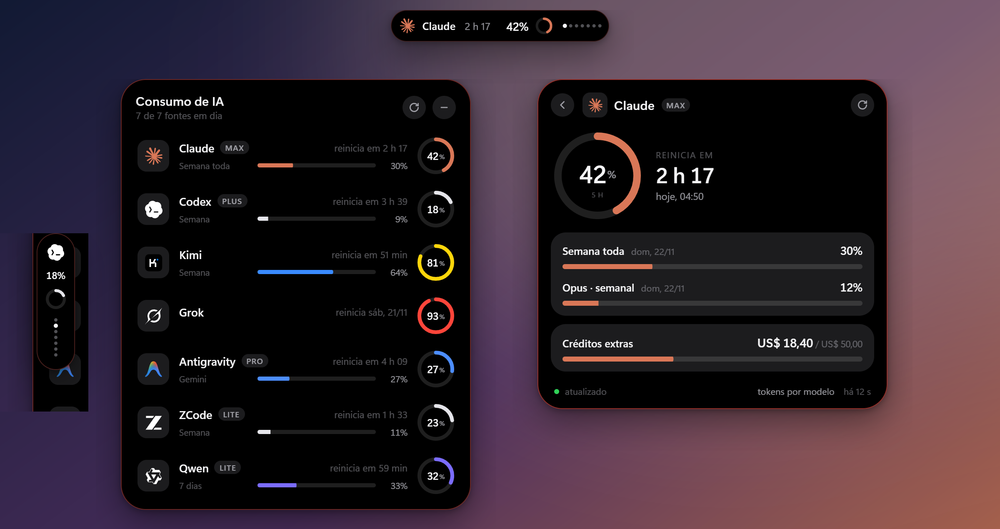
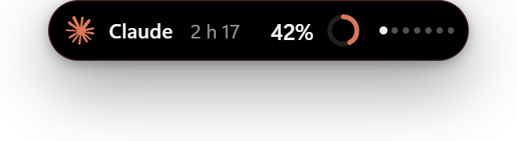
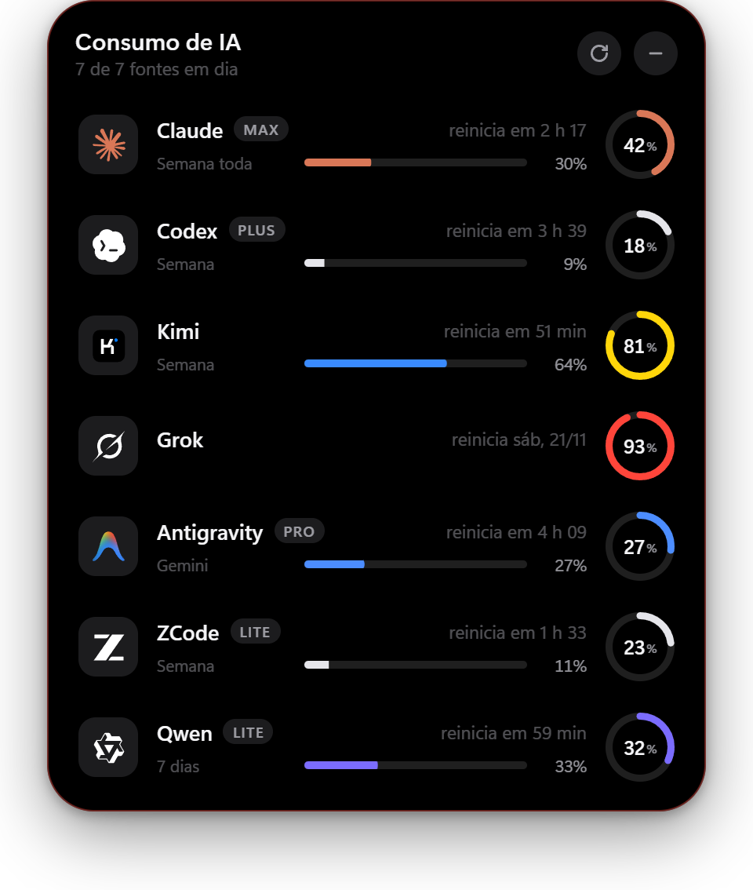
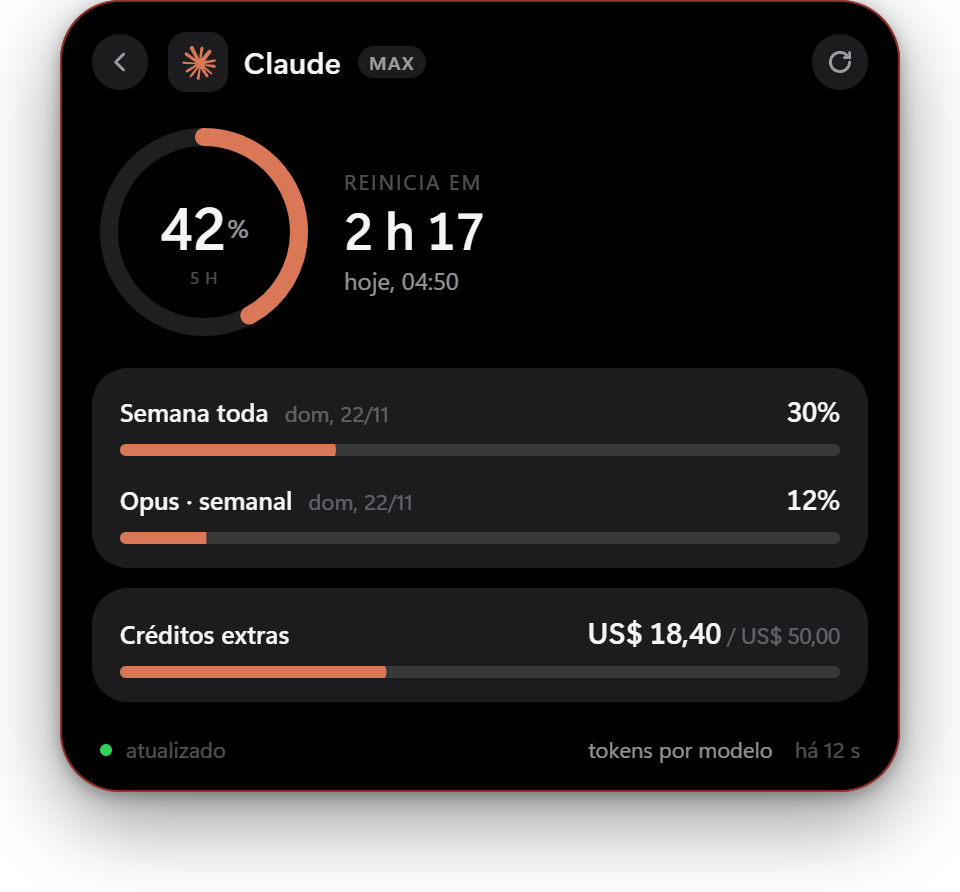
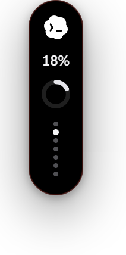

# claude-widget

Uma "ilha dinâmica" para Windows, no estilo do iPhone, que mostra quanto você
já gastou de cada ferramenta de IA de código: **Claude Code, Codex, Kimi Code,
Grok Build, Google Antigravity, ZCode (Z.ai) e Qwen Code**.

Fica como uma pílula preta no centro do topo da tela, alternando entre as fontes
como uma Live Activity. Passe o mouse e ela se expande numa lista com todas as
fontes. Clique numa delas para ver o painel completo: sessão curta, janelas
semanais, créditos extras e, no Claude, os tokens gastos por modelo.

<p align="center">
  
</p>

<table>
  <tr>
    <td align="center"><br><sub>Pílula: alterna entre as fontes</sub></td>
    <td align="center" rowspan="2"><br><sub>Mouse em cima: todas as fontes</sub></td>
    <td align="center" rowspan="2"><br><sub>Clique: o detalhe de uma fonte</sub></td>
  </tr>
  <tr>
    <td align="center"><br><sub>Presa na lateral: vertical</sub></td>
  </tr>
</table>

> As imagens usam o modo de demonstração (`CLAUDE_WIDGET_DEMO=1`), com números fictícios.

## Download

Baixe o instalador em **[Releases → última versão](https://github.com/giovani-junior-dev/claude-widget/releases/latest)**
(`Claude-Widget-Setup-<versão>.exe`), rode e pronto: a ilha aparece no topo da
tela e o ícone fica na bandeja. Quem já tem uma versão instalada recebe a
atualização sozinho na próxima abertura.

O instalador não é assinado, então o Windows SmartScreen pode avisar na primeira
vez: **Mais informações → Executar assim mesmo**.

## Por que existe

Os limites que importam são invisíveis até estourarem. A sessão de 5 h reinicia
em horário móvel, a janela semanal reinicia em outro, e cada ferramenta tem a
sua regra. Descobrir o estado exige abrir sete painéis diferentes — atrito
suficiente para ninguém fazer, o que leva a bater no limite no meio de uma
tarefa longa, sem aviso.

## A ilha

| Estado | Como chega | O que mostra |
|---|---|---|
| Pílula | sempre visível | logo, contagem regressiva, % e anel da fonte atual; troca de fonte a cada 6 s |
| Expandida | mouse em cima | uma linha por fonte: anel da janela curta, barra da semana, plano e reinício |
| Detalhe | clique numa fonte | mostrador grande, todas as janelas, créditos e tokens por modelo (Claude) |

Fora da pílula, os cliques passam direto para a janela de baixo. A borda respira
em vermelho quando alguma fonte entra em estado crítico. `Esc` volta um nível.

**Arrastar.** Segure a ilha (fora dos botões) e puxe: ela encolhe para pílula e
segue o cursor. Ao soltar, prende no lado mais próximo e passa a crescer para
dentro da tela. Perto da base, por exemplo, ela abre para cima. Solte perto do
topo central, ou use **Voltar ao topo** na bandeja, para devolvê-la ao lugar
original.

**Esconder fontes.** No menu da bandeja, em **Fontes**, desmarque as contas que
você não usa mais. Elas somem da ilha e deixam de ser consultadas. Pelo menos
uma fica sempre visível.

## De onde vêm os números

| Fonte | Credencial (só leitura, salvo o Kimi) | Endpoint |
|---|---|---|
| Claude Code | `~/.claude/.credentials.json` | `api.anthropic.com/api/oauth/usage` |
| Codex | `~/.codex/auth.json` | `chatgpt.com/backend-api/wham/usage` |
| Kimi Code | `~/.kimi-code/credentials/kimi-code.json` | `api.kimi.com/coding/v1/usages` |
| Grok Build | `~/.grok/auth.json` | `cli-chat-proxy.grok.com/v1/billing` |
| Antigravity | Gerenciador de Credenciais do Windows, alvo `gemini:antigravity` (gravado pelo `agy`) | `daily-cloudcode-pa.googleapis.com/v1internal:retrieveUserQuotaSummary` e `:fetchAvailableModels` |
| ZCode | `~/.zcode/v2/credentials.json`, cifrado pelo app (AES-256-GCM) | `api.z.ai/api/monitor/usage/quota/limit` |
| Qwen (Token Plan da QwenCloud) | sessão do console, feita uma vez em **Conectar QwenCloud…** na bandeja | painel `home.qwencloud.com/analytics/token-plan`, lido numa janela invisível |
| Qwen Code (Coding Plan, sem QwenCloud conectada) | nenhuma: lê `~/.qwen/projects/*/chats/*.jsonl` | nenhum, é local |

Detalhes que não são óbvios:

- **Antigravity** junta duas consultas. O resumo por grupo
  (`retrieveUserQuotaSummary`) traz a semana e as 5 h do grupo Claude/GPT, os
  mesmos números do `/credits` do `agy`. A cota por modelo
  (`fetchAvailableModels`) cobre a janela de 5 h do Gemini. **A semana do Gemini e
  a cota da Argon ficam de fora:** o `agy` busca esses números por um canal
  interno que outro programa não alcança, e o widget prefere não inventar.
- **ZCode** guarda o token cifrado com uma chave derivada do usuário do Windows,
  a mesma que o app usa. O widget decifra só em memória e nunca regrava o arquivo.
- **Qwen (Token Plan)** não tem API pública de uso: a própria documentação da
  QwenCloud manda olhar o console. Em **Conectar QwenCloud…**, no menu da
  bandeja, abre uma janela com o login da QwenCloud. Você entra uma vez, e a
  sessão fica guardada só no perfil do widget. A cada ciclo o widget abre o painel
  de uso numa janela invisível e lê o que ele mostra: gasto do mês, Credits
  usados sobre a cota e o reinício. Se a sessão cair, a fonte avisa para
  reconectar. **Desconectar QwenCloud** apaga a sessão.
- **Qwen Code sem QwenCloud conectada** usa o Coding Plan antigo do Model Studio:
  conta as requisições (`qwen-code.api_response`) no histórico local, em janelas
  móveis de 5 h, 7 e 30 dias, contra o limite do plano (Lite ou Pro, escolhido na
  bandeja). É estimativa, e a tela avisa isso.
- **Tokens por modelo** (só Claude) vêm dos transcripts locais e refletem
  apenas esta máquina.

Nas fontes que mandam severidade (Claude), a cor de alerta vem da API. Nas
outras, âmbar a partir de 75% e vermelho a partir de 90%.

## Rodar a partir do código

Requisitos: Windows 10/11 64 bits, Node.js 22.12 ou mais novo. Cada fonte
aparece sozinha quando a ferramenta correspondente estiver instalada e logada.

```powershell
git clone https://github.com/giovani-junior-dev/claude-widget.git
cd claude-widget

npm install
npm run preparar   # baixa o binário do Electron, ~100 MB, só na primeira vez
npm test
npm start
```

O passo `npm run preparar` não é opcional: o Electron 43 **não** baixa o binário
durante o `npm install`. Sem esse passo, o `npm start` parece travado enquanto
baixa 100 MB em silêncio.

## Uso

| Onde | O quê |
|---|---|
| Pílula | Passe o mouse para expandir, segure e puxe para mudar de lugar |
| ↻ | Atualiza tudo (na lista) ou só a fonte (no detalhe) |
| — | Recolhe para a bandeja |
| Ícone da bandeja | Mostra e esconde; clique direito abre o menu |
| Menu da bandeja | Monitor, voltar ao topo, fontes visíveis, plano do Qwen, iniciar com o Windows |

### Abrir junto com o Windows

Pelo menu da bandeja, em **Iniciar com o Windows**, ou pelo terminal:

```powershell
npm run autostart:on
npm run autostart:off
npm run autostart:status
```

## Privacidade

- As credenciais são lidas **somente para leitura**. A exceção é o Kimi Code, cujo
  token dura 15 min: o widget renova e regrava o par no mesmo formato do CLI,
  senão o login dele quebraria.
- Os tokens ficam no processo principal e **nunca chegam à janela**: para lá vão
  apenas números e textos já prontos. O renderer roda com isolamento de contexto,
  sem Node, e só carrega o HTML e as logos locais.
- Conexões de rede: só os endpoints da tabela acima. Não há telemetria.
- Quando um token expira, o widget avisa e espera a ferramenta renovar.

## Comportamento em falhas

| Situação | O que acontece |
|---|---|
| Credencial expirada | Ponto âmbar na fonte e aviso no detalhe dizendo o que abrir; último valor em cinza |
| Sem conexão | Continua tentando, dobrando o intervalo de 5 até 30 minutos |
| Ferramenta nunca usada nesta máquina | A fonte não aparece |
| Campo ausente na resposta | Travessão, nunca `0%` |

## Desenvolvimento

```powershell
npm test
npm run icons            # regenera os ícones da bandeja
```

Modo de demonstração, com números fictícios e preferências em pasta separada
(não toca credenciais nem rede):

```powershell
$env:CLAUDE_WIDGET_DEMO = '1'; npm start
```

Publicar uma versão: suba o `version` do `package.json`, crie a tag `v<versão>`
e faça push dela. O GitHub Actions gera o instalador e publica o release.

Estrutura:

```
main.js                 janela, bandeja, ciclo único de atualização, hover, IPC
preload.js              ponte mínima entre processo principal e janela
index.html, renderer.js a ilha: pílula, lista e detalhe
assets/logos/           logos das fontes (svgl.app; ZCode redesenhado do ícone do app)
lib/providers.js        registro das fontes: credencial, busca e conversão de cada uma
lib/*-creds.js          leitura das credenciais locais
lib/*-usage.js          as chamadas HTTP (Qwen: contagem no disco)
lib/*-view-model.js     resposta crua -> formato de tela comum (funções puras)
lib/token-usage.js      tokens por modelo do Claude, com índice incremental
lib/window-state.js     preferências guardadas
lib/poll-policy.js      intervalo entre consultas e recuo em caso de falha
lib/autostart.js        o atalho da pasta Inicializar
lib/demo.js             dados fictícios do modo de demonstração
test/                   fixtures com a estrutura real das APIs e as verificações
```

Para somar uma fonte nova: um `*-creds.js`, um `*-usage.js`, um `*-view-model.js`,
uma entrada em `lib/providers.js` e a logo em `assets/logos/<id>.svg`.

O hover é detectado pelo processo principal, consultando o cursor a cada 50 ms:
no Windows, uma janela transparente que deixa o clique passar não recebe os
eventos de mouse encaminhados.

## Limitações conhecidas

- **Só Windows.** O Antigravity lê o Gerenciador de Credenciais do Windows e o
  início automático usa a pasta Inicializar.
- **Qwen é estimativa local**, ver acima.
- **Antigravity e ZCode usam endpoints internos** dos próprios apps. Se eles
  mudarem, a fonte vira erro sem derrubar as outras.
- **Não é oficial** e não tem vínculo com nenhum dos provedores.

## Licença

MIT — veja [LICENSE](LICENSE).
